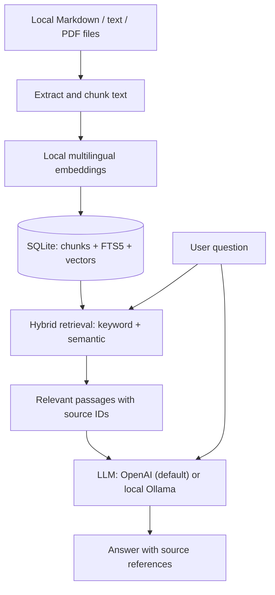

# Basic RAG Platform

**Learn retrieval-augmented generation (RAG) by building a transparent, testable document question-answering system in Python.**

> **Project status: Work in progress.** This is an educational engineering lab. The core lab code, sample documents, tests, and retrieval evaluation set are in the repository; end-to-end behavior with real models is being verified milestone by milestone. It is **not production-ready** and should not be used with confidential or regulated data.

## Overview

Retrieval-augmented generation combines information retrieval with a language model. Instead of asking an LLM to answer from its training data alone, a RAG application searches a controlled document collection and supplies relevant passages as context for an answer.

This repository explores that process **without hiding the core logic behind an orchestration framework**. The goal is to understand how each stage works, measure where it fails, and build the foundations for more reliable document-based AI applications.

The initial use case is a fictitious industrial equipment supplier. Its synthetic warranty and support policies make it possible to test factual questions, source citations, missing information, conflicting documents, and unsafe commercial promises.

### Learning goals

- Extract and chunk Markdown, plain-text, and text-based PDF documents.
- Generate local multilingual embeddings and store document metadata.
- Compare **keyword search** with **semantic search**.
- Combine results using **hybrid retrieval** and Reciprocal Rank Fusion (RRF).
- Generate document-grounded answers using an LLM (OpenAI by default, local Ollama optional).
- Display traceable source references and understand their limitations.
- Evaluate retrieval separately from generated answers.
- Test failure scenarios: stale indexes, irrelevant results, conflicting policies, and prompt injection.

## Architecture



This is a deliberately small-corpus architecture: vectors are stored in SQLite and compared in Python, rather than indexed by a dedicated vector database. That makes the retrieval logic easier to inspect, but it is not designed for large-scale deployment.

Ingestion, embeddings, and retrieval always run locally. Only the generation step is pluggable: with the default OpenAI provider, **the question and the retrieved passages are sent to the OpenAI API**; with Ollama, nothing leaves the machine.

## Technology stack

| Component | Choice | Why |
| --- | --- | --- |
| Language | Python 3.11+ | Clear, testable implementation |
| LLM (default) | OpenAI `gpt-5.4-nano` via the `openai` SDK | Runs on any machine; inexpensive for short grounded answers |
| LLM (optional) | Ollama with `qwen2.5:1.5b` | Fully local generation when hardware allows |
| Embeddings | `sentence-transformers/paraphrase-multilingual-MiniLM-L12-v2` | Local, multilingual semantic representations |
| Storage | SQLite | Minimal setup and inspectable data |
| Keyword search | SQLite FTS5 / BM25 | Retrieve exact words and terms |
| Semantic ranking | NumPy vector similarity | Make vector search mechanics explicit |
| Hybrid ranking | Reciprocal Rank Fusion | Combine lexical and semantic rankings |
| PDF extraction | `pypdf` | Extract text from PDFs with a text layer |
| Tests | `pytest` | Check parsing, citations, indexing, and retrieval |
| Optional API | FastAPI | Expose the lab through a local HTTP endpoint |

**No LangChain is required for the core implementation.** The initial dependency and embedding-model downloads require an internet connection.

## Getting started

### Prerequisites

- Python 3.11 or newer
- Git
- An [OpenAI API key](https://platform.openai.com/api-keys) (needed only for the `ask` command)
- Enough free disk space for Python dependencies and the embedding model

### 1. Clone the repository

```bash
git clone https://github.com/mazarzycki/basic-rag-platform.git
cd basic-rag-platform
```

### 2. Create a Python environment

```bash
python3 -m venv .venv
source .venv/bin/activate
python -m pip install --upgrade pip
python -m pip install -r requirements.txt
```

**Linux without an NVIDIA GPU:** install the CPU-only PyTorch build *before* `requirements.txt`. Otherwise pip pulls the CUDA build, which adds roughly 4 GB of GPU libraries you cannot use:

```bash
python -m pip install torch --index-url https://download.pytorch.org/whl/cpu
python -m pip install -r requirements.txt
```

macOS and Windows get a suitable build from the default command.

On Windows, activate the environment with `.venv\Scripts\activate` in Command Prompt or `.venv\Scripts\Activate.ps1` in PowerShell.

### 3. Configure the LLM

```bash
cp .env.example .env
```

Edit `.env` and set `OPENAI_API_KEY`. The `.env` file is git-ignored; never commit it. Optionally change `OPENAI_MODEL`.

<details>
<summary>Optional: use a local Ollama model instead</summary>

Requires a machine that can run a local LLM. Install [Ollama](https://ollama.com/download), then:

```bash
ollama pull qwen2.5:1.5b
ollama run qwen2.5:1.5b "Explain RAG in one sentence."
```

Set `LLM_PROVIDER=ollama` in `.env`. If Ollama is not running as a service, start `ollama serve` in a separate terminal.

</details>

### 4. Index the sample documents

```bash
python rag_lab.py index
```

The first run downloads the embedding model. After that, you can uncomment `HF_HUB_OFFLINE=1` in `.env` to skip Hugging Face's online update check on every start (about 1 second). Re-running `index` fully rebuilds the generated SQLite index in `data/`; it never modifies the source documents.

### 5. Inspect retrieval before generating answers

```bash
python rag_lab.py search "standard warranty"
python rag_lab.py search "How do I contact support?"
```

Inspect which chunks are retrieved and why. This is an essential part of learning to debug RAG systems.

### 6. Ask a question

```bash
python rag_lab.py ask "How long is the standard warranty?"
```

The output is structured JSON containing an answer, a status, and source references such as `warranty.md` / `Standard coverage`.

### Faster: interactive session

Each `search` or `ask` command starts a new Python process and reloads PyTorch and the embedding model, which can take 10+ seconds on a modest CPU. The search itself takes well under a second. To pay the loading cost only once:

```bash
python rag_lab.py chat
```

Type a question to run `ask`, `/search <question>` for retrieval only, and `/quit` to exit.

### 7. Run tests and retrieval evaluation

```bash
python -m pytest -q
python rag_lab.py evaluate evals.jsonl
```

The tests use a fake embedding model and a stubbed LLM, so they need no API key, no Ollama, and no model download. The evaluation reports **Hit@4**: whether an expected source appears among the top four retrieved chunks. It does **not** measure whether the model's final answer is correct.

For the complete explanation and full code listings, see **[the enhanced hands-on tutorial](docs/tutorial.md)**.

## Repository structure

```text
basic-rag-platform/
├── README.md
├── LICENSE
├── .gitignore
├── .env.example           # LLM provider settings template (copy to .env)
├── requirements.txt       # Python dependencies
├── docs/
│   └── tutorial.md        # Full walkthrough and engineering exercises
├── knowledge/
│   ├── warranty.md        # Synthetic sample document
│   └── support.md         # Synthetic sample document
├── rag_lab.py             # Indexing, search, and RAG CLI
├── test_rag_lab.py        # Focused automated tests
├── evals.jsonl            # Labeled retrieval questions
└── data/                  # Generated SQLite index; not committed
```

## Development roadmap

- [ ] **Milestone 1 — Local document ingestion:** Discover documents, extract text, split sections into chunks, and index them.
- [ ] **Milestone 2 — Retrieval:** Implement SQLite FTS5 keyword search, local embeddings, semantic similarity, and hybrid ranking.
- [ ] **Milestone 3 — Grounded generation:** Send retrieved passages to the LLM (OpenAI or Ollama) and return answers with source markers.
- [ ] **Milestone 4 — Testing and evaluation:** Add unit tests, a labeled dataset, and retrieval metrics.
- [ ] **Milestone 5 — Failure analysis:** Explore unsupported questions, stale and conflicting information, multilingual queries, and prompt injection.
- [ ] **Milestone 6 — Optional local API:** Wrap the question-answering function in FastAPI and document its limitations.

Progress will be reflected by checking off milestones as the implementation is verified.

## Key design and safety considerations

This repository is a **learning tool, not a secure enterprise product**.

- **Citations are not proof of correctness.** A marker such as `[S1]` may point to a retrieved chunk without supporting the model's specific claim.
- **Relevant retrieval is not guaranteed.** Vector search can return plausible-looking passages even when the answer is absent.
- **RAG does not eliminate hallucinations or prompt injection.** Retrieved documents and user inputs must be treated as untrusted content.
- **The default LLM is a hosted service.** Retrieved passages and questions are sent to OpenAI and are subject to its data-usage terms. Use `LLM_PROVIDER=ollama` if text must stay on the machine.
- **No document-level authorization is implemented.** Do not upload employer information, customer data, credentials, or private documents.
- **The optional API is for localhost experimentation.** It does not include production authentication, rate limits, or operational safeguards.
- **Small-corpus optimization only.** The project intentionally does not implement a scalable vector index, incremental ingestion, or enterprise-grade observability.

The synthetic warranty scenario is particularly useful for testing whether the system invents refunds, discounts, or warranty extensions. The LLM must not be trusted to authorize any such action.

## What comes after this lab?

This repository is intentionally separate from a future **commercial AI Knowledge Platform**. A production-oriented system would require, among other things, permission-aware retrieval, document versioning and approval workflows, stronger evaluation, scalable indexing (for example, PostgreSQL with pgvector), auditability, monitoring, and robust API security. MCP or a customer-facing chatbot would be optional integration layers, not prerequisites for learning the RAG pipeline.

## References and inspiration

- [Enhanced hands-on tutorial](docs/tutorial.md) — implementation guide maintained in this repository
- [freeCodeCamp: RAG Explained Simply with a Real Project](https://www.freecodecamp.org/news/rag-explained-simply-with-a-real-project/) — conceptual inspiration; this project uses an original implementation
- [SQLite FTS5 documentation](https://www.sqlite.org/fts5.html)
- [Sentence Transformers documentation](https://sbert.net/)
- [OpenAI Chat Completions API](https://developers.openai.com/api/reference/resources/chat)
- [Ollama documentation](https://docs.ollama.com/)
- [OWASP: Prompt Injection](https://genai.owasp.org/llmrisk/llm01-prompt-injection/)

## License

MIT — see [LICENSE](LICENSE). Third-party packages and downloaded model weights are subject to their own licenses and terms.
